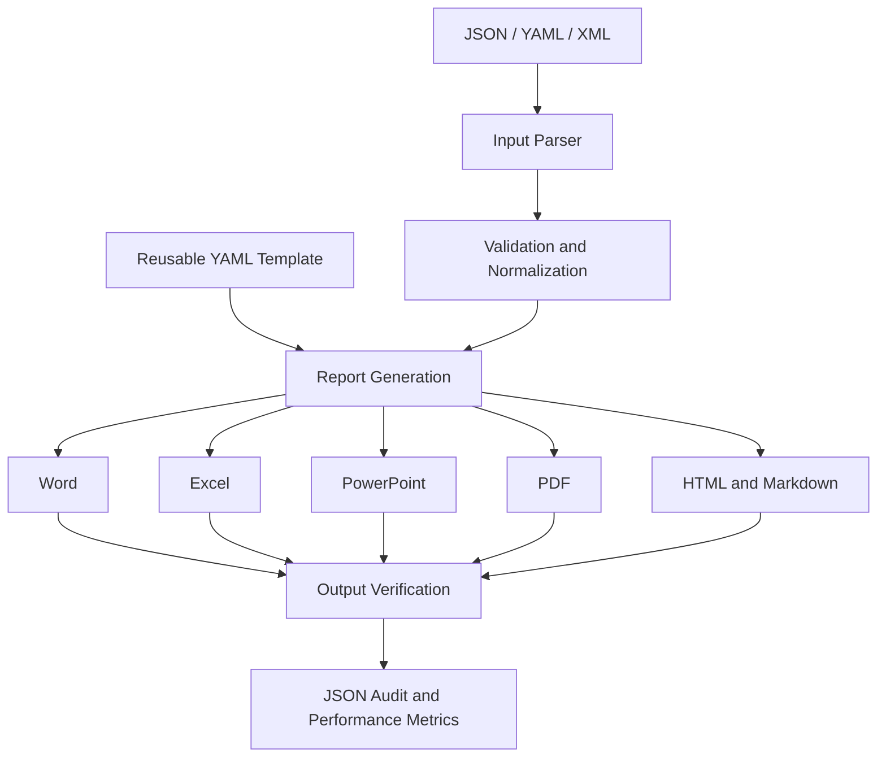
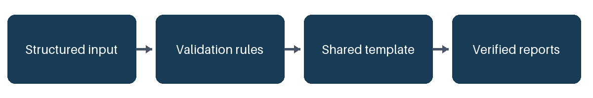

# DocuFlow

## Engineering Documentation Automation

DocuFlow is a Python-based engineering documentation automation
system that transforms structured technical specifications into
consistent Word, Excel, PowerPoint, PDF, HTML and Markdown reports.

It combines reusable templates, numerical validation, technical
diagram generation, cross-format verification and measurable
workflow evaluation.

## Problem Statement

Engineering teams frequently maintain specifications across
multiple document formats. Repeated manual updates can introduce
inconsistent values, missing content and unnecessary documentation
effort.

DocuFlow explores a single-source documentation workflow in which
structured engineering specifications are validated and used to
generate multiple technical deliverables.

## Features

- Parse engineering specifications from JSON, YAML and XML.
- Validate required fields, duplicate parameters and numeric limits.
- Detect out-of-range engineering values.
- Generate six document formats from a shared specification.
- Apply reusable report templates and consistent formatting.
- Generate technical workflow diagrams automatically.
- Create editable Word documents and PowerPoint presentations.
- Produce Excel workbooks with filtering and validation highlighting.
- Reopen generated documents to verify specification consistency.
- Verify individual PDF table cells using their page coordinates.
- Record validation outcomes in structured JSON audit reports.
- Measure processing time using repeatable benchmark runs.
- Include ten automated tests.

## Architecture



## Demonstration

The example dataset contains six fictional engineering parameters
for a synthetic memory interface. Five parameters fall within their
defined limits and one operating temperature exceeds its maximum.

These are educational values, not actual hardware specifications
or confidential semiconductor IP.

### Example Deliverables

- [PDF engineering report](demo/report.pdf)
- [Word engineering report](demo/report.docx)
- [Excel specification workbook](demo/report.xlsx)
- [PowerPoint presentation](demo/report.pptx)
- [HTML technical report](demo/report.html)
- [Markdown report](demo/report.md)
- [Validation audit](demo/audit.json)
- [Performance benchmark](demo/benchmark.json)



## Installation

Windows PowerShell:

```powershell
py -m venv .venv
.\.venv\Scripts\python.exe -m pip install -r requirements.txt
```

## Usage

```powershell
.\.venv\Scripts\python.exe docuflow.py generate
```

The default input is sample.json and the default reusable
template is template.yaml.

Alternative input formats:

```powershell
.\.venv\Scripts\python.exe docuflow.py generate --input sample.yaml --out output/yaml
.\.venv\Scripts\python.exe docuflow.py generate --input sample.xml --out output/xml
```

## Reusable Templates

The YAML template controls the report title, accent colour and
review footer independently of the source specification.

## Output Verification

The application reopens generated documents and compares their
specification data against normalized source rows.

PDF verification extracts individual table cells from their page
coordinates. Word, Excel, PowerPoint, HTML and Markdown content
is checked against the corresponding expected specification rows.

A verification failure is reported rather than silently accepting
inconsistent output.

An out-of-range engineering value is preserved and marked FAIL.
The application does not automatically change engineering values.

## Testing

```powershell
.\.venv\Scripts\python.exe -m unittest -v
```

The ten tests cover equivalent JSON, YAML and XML inputs,
numerical boundaries, missing metadata, duplicate parameters,
invalid values, six-format output generation, modified Excel
output, multi-page documents, template reuse and benchmarking.

## Performance Evaluation

```powershell
.\.venv\Scripts\python.exe docuflow.py benchmark --runs 5
```

The benchmark measures end-to-end document generation and
automated consistency verification across multiple runs.

The results report median processing time.

An optional measured manual baseline can be supplied through
--manual-seconds. No manual time reduction is claimed unless
a comparable manual baseline has actually been measured.

## Technology Stack

Python, python-docx, openpyxl, python-pptx, ReportLab,
PyMuPDF, Pillow, PyYAML, JSON, XML, Markdown, HTML, Git
and Python unittest.

## Limitations

DocuFlow is an educational prototype supporting a defined
specification schema, trusted structured inputs, printable ASCII
text and up to 100 parameter records.

Templates control selected formatting attributes rather than
arbitrary customer document layouts.

Excel specification values are stored as literal strings to
preserve their decimal representations.

Automated verification covers specification table content.
It does not guarantee every visual formatting property,
metadata field or the correctness of an engineering design.

The system does not use an LLM. Human review remains necessary
before releasing official engineering documentation.

## Author

Mustafa Al-Juboori

Software Engineering Student

Carleton University, Ottawa, Canada
